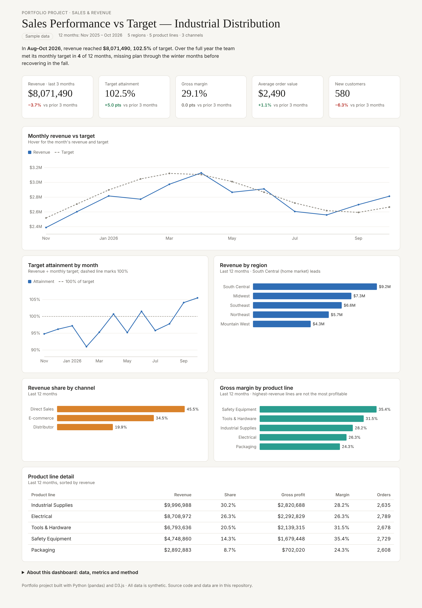

# Sales Performance vs Target Dashboard 📈

An end-to-end sales analytics project: synthetic order-level data and a monthly sales plan → Python & SQL metrics → an interactive D3.js dashboard tracking revenue against target, margin, and performance by region, channel and product line for a B2B industrial distributor.

**🔗 Live dashboard:** `https://<your-github-username>.github.io/sales-performance-dashboard/`



---

## Business question

> Are we hitting our revenue targets, and which regions, channels and product lines drive revenue and profit?

## Key findings

| Metric (Aug–Oct 2026) | Value | vs May–Jul 2026 |
|---|---|---|
| Revenue | $8.07M | −3.7% (seasonal) |
| Target attainment | 102.5% | +5.0 pts |
| Gross margin | 29.1% | flat |
| Average order value | $2,490 | +1.1% |
| New customers | 580 | −6.3% |

- **The year finished strong but started behind plan.** The team met its monthly target in 4 of 12 months. It missed every month from November through March, then beat target in September and October. Full-year revenue was $33.1M against a $33.9M plan (97.8%).
- **The biggest product lines are not the most profitable.** Industrial Supplies and Electrical bring in 57% of revenue but earn 28% and 26% margin. Safety Equipment (35.4%) and Tools & Hardware (31.5%) earn the most per dollar sold.
- **Packaging is the weakest line**, with the lowest revenue share (8.7%) and the lowest margin (24.3%).
- **South Central, the home market, leads** with 28% of revenue. Direct Sales brings in 45% of revenue, and E-commerce is a strong second at 35%.

## Recommendations

1. Protect margin on Safety Equipment and Tools & Hardware in promotions, and cross-sell them into Industrial Supplies accounts.
2. Review discounting and pricing on Packaging.
3. Build Q1 pipeline coverage earlier to avoid repeating the winter shortfall.

## What's in the dashboard

- KPI cards with change vs the prior 3 months
- Monthly revenue vs target (target shown dashed)
- Target attainment by month against a 100% line
- Revenue by region, revenue share by channel, gross margin by product line
- Product line detail table
- Hover tooltips on every chart; responsive down to phone width; light and dark mode

## Tech stack

| Layer | Tools |
|---|---|
| Data generation & cleaning | Python, pandas, NumPy |
| Metrics | pandas, plus equivalent **PostgreSQL** queries in [`sales_metrics.sql`](sales_metrics.sql) (joins, running totals, `RANK()`) |
| Visualization | D3.js v7, HTML, CSS (no build step) |
| Hosting | GitHub Pages |

## Project structure

```
├── index.html            # the dashboard (open in a browser)
├── data.js               # summary tables bundled for the page (built by build_metrics.py)
├── charts.js             # reusable D3 line, bar and horizontal-bar charts with tooltips
├── dash-lite.js          # small data + redraw layer
├── style.css, tokens.css # layout and light/dark theme
├── d3.min.js             # D3 v7.9 (ISC license)
├── generate_data.py      # creates the synthetic raw data (fixed seed, reproducible)
├── build_metrics.py      # cleans and aggregates raw data into summary tables + data.js
├── sales_metrics.sql     # the same metrics in SQL (PostgreSQL)
├── sales_orders.csv, sales_targets.csv   # raw data: ~13,400 order lines + monthly target plan
├── sales_kpis/monthly/regions/categories/channels.csv   # summary tables the dashboard reads
├── requirements.txt
└── dashboard.png         # screenshot
```

## Run it yourself

```bash
pip install -r requirements.txt
python generate_data.py
python build_metrics.py
```

Then open `index.html` in any browser.

## Metric definitions

- **Target attainment** = revenue ÷ planned revenue target for the same period
- **Gross margin** = (revenue − cost of goods) ÷ revenue, after discounts
- **Average order value** = revenue ÷ number of orders
- **New customers** = orders from first-time customers

## About the data

All data is **synthetic**. It was generated with Python to resemble a B2B industrial distributor with 5 regions, 5 product lines and 3 sales channels, including seasonality, growth, discounting and product-line margin differences. No real company or customer data is used.
